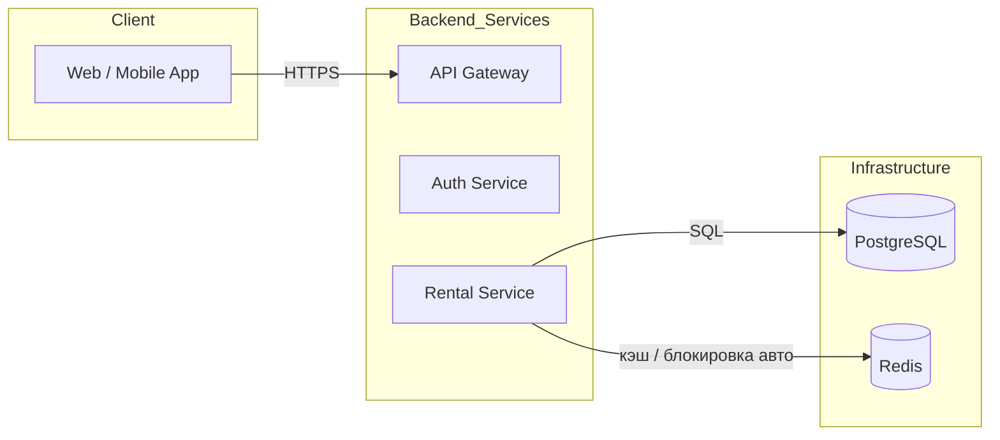
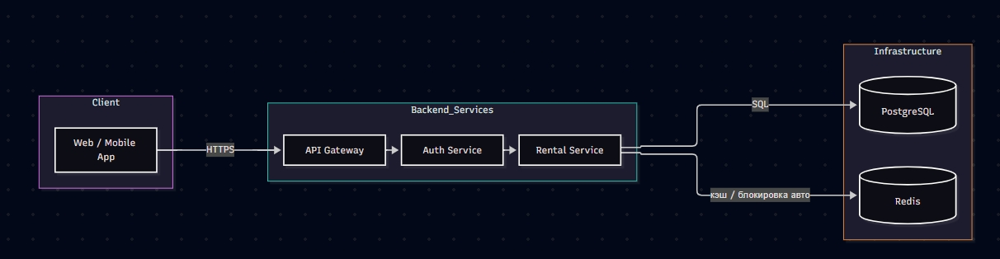
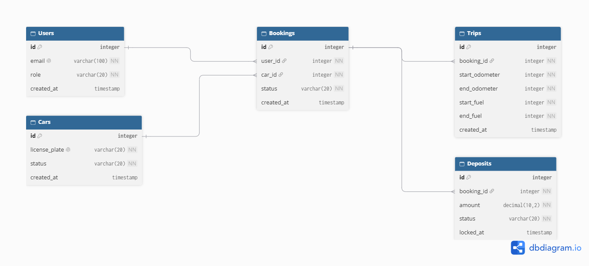

# Carsharing / Rental API

## 1. Назначение

Сервис для бронирования и учёта поездок в каршеринге. Фиксирует пробег и уровень топлива при начале и завершении поездки, отслеживает статус автомобиля и управляет депозитом (блокировка → списание или возврат).

---

## 2. Ролевая модель и сценарии использования (Use Cases)

| Роль | Сценарии (Use Cases) |
|---|---|
| Водитель | Поиск свободных автомобилей (фильтр по району/типу); создание бронирования; начало и завершение поездки (фиксация пробега, уровня топлива, фото повреждений); просмотр истории поездок; проверка статуса депозита |
| Оператор автопарка | Добавление и изменение данных об автомобиле (статусы: «доступен», «в аренде», «на обслуживании»); управление тарифами; обработка инцидентов (повреждения, списание или возврат депозита); просмотр аналитики по загруженности парка |

---

## 3. Архитектура (C4, уровень Container)

### 3.1. Исходный код диаграммы (Mermaid.js)

### 3.2. Экспортированное изображение

### 3.3. Описание контейнеров

| Контейнер | Назначение |
|---|---|
| Web / Mobile App | Приложение водителя и оператора: поиск авто, бронирование, завершение поездки |
| API Gateway | Единая точка входа: маршрутизация запросов, ограничение частоты обращений |
| Auth Service | Регистрация, вход, проверка роли (водитель / оператор), выдача токенов |
| Rental Service | Бизнес-логика: бронирования, поездки, пробег и топливо, депозиты, статусы авто |
| PostgreSQL | Основное хранилище данных: пользователи, автомобили, бронирования, поездки, депозиты |
| Redis | Кэш статусов автомобилей и распределённые блокировки («авто занят») |

---

## 4. Модель данных (ER-диаграмма, 3NF)

### 4.1. Список сущностей

| Сущность | Назначение | Ключевые поля |
|---|---|---|
| Users | Пользователи системы | id, email (UNIQUE), role (driver / operator) |
| Cars | Автомобили автопарка | id, license_plate (UNIQUE), status |
| Bookings | Бронирования | id, user_id (FK), car_id (FK), status |
| Trips | Поездки с показателями | id, booking_id (FK), start/end_odometer, start/end_fuel |
| Deposits | Депозиты по бронированиям | id, booking_id (FK), amount, status |

### 4.2. Изображение ER-диаграммы

### 4.3. Ограничения целостности

| Таблица | Ограничение | Тип |
|---|---|---|
| Users | id — первичный ключ | PK |
| Users | email — уникальный, не пустой | UNIQUE, NOT NULL |
| Users | role IN ('driver', 'operator') | CHECK |
| Cars | id — первичный ключ | PK |
| Cars | license_plate — уникальный, не пустой | UNIQUE, NOT NULL |
| Cars | status IN ('available', 'rented', 'maintenance') | CHECK |
| Bookings | user_id, car_id — внешние ключи | FK |
| Bookings | status — не пустой | NOT NULL |
| Trips | booking_id — внешний ключ | FK |
| Trips | start_odometer, end_odometer, start_fuel, end_fuel — не пустые | NOT NULL |
| Deposits | booking_id — внешний ключ | FK |
| Deposits | amount — не пустой | NOT NULL |
| Deposits | status IN ('locked', 'refunded', 'forfeited') | CHECK |

### 4.4. Индексы

| Таблица | Индексируемое поле | Назначение |
|---|---|---|
| Bookings | user_id | Быстрый поиск бронирований водителя |
| Bookings | car_id | Поиск бронирований автомобиля |
| Trips | booking_id | Поиск поездок по бронированию |
| Deposits | booking_id | Поиск депозита по бронированию |

### 4.5. Обоснование 3NF

Схема удовлетворяет третьей нормальной форме: все атрибуты зависят только от первичного ключа своей таблицы, транзитивные зависимости между неключевыми атрибутами отсутствуют. Статус автомобиля хранится один раз в `Cars` (а не дублируется в поездках), история депозитов вынесена в отдельную таблицу `Deposits` с привязкой к `Bookings`, а справочники статусов оформлены ограничениями CHECK, а не повторяющимися строками.

---

## 5. Инструменты

- C4-диаграмма: Mermaid.js ([mermaid.live](https://mermaid.live)), исходник — `diagrams/c4_container.mmd`, экспорт — `diagrams/c4_container.png`.
- ER-диаграмма: dbdiagram.io (DBML), исходник — `diagrams/erd.dbml`, экспорт — `diagrams/erd.png`.

---

## 6. REST API

Спецификация OpenAPI 3.0: [openapi3.yaml](openapi3.yaml)

| Метод | URI | Описание | Доступ (роль) | Код |
|---|---|---|---|---|
| POST | /api/v1/auth/login | Вход, выдача токена | Все | 200 OK |
| GET | /api/v1/users | Список пользователей | Авторизованный | 200 OK |
| POST | /api/v1/users | Создание пользователя | Оператор | 201 Created |
| GET | /api/v1/cars | Список автомобилей (фильтр по статусу) | Авторизованный | 200 OK |
| POST | /api/v1/cars | Добавление автомобиля | Оператор | 201 Created |
| PUT | /api/v1/cars/{id} | Обновление статуса автомобиля | Оператор | 200 OK |
| DELETE | /api/v1/cars/{id} | Удаление автомобиля | Оператор | 204 No Content |
| GET | /api/v1/bookings | Список бронирований | Авторизованный | 200 OK |
| POST | /api/v1/bookings | Создание бронирования | Пользователь | 201 Created |
| DELETE | /api/v1/bookings/{id} | Отмена бронирования | Пользователь | 204 No Content |
